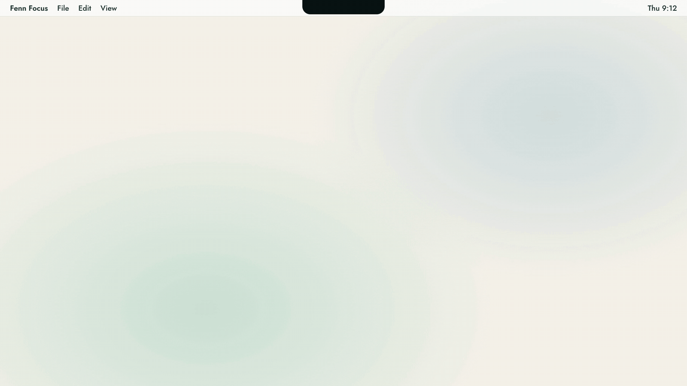

<div align="center">



# Fenn Focus

**A free, local-first AI assistant that lives in your Mac's notch.**

Tasks, calendar, routines, notes and focus sessions in one small island, plus Fenn, a pebble who plans your day with
you. The AI runs on your Mac with MLX, Ollama, LM Studio or Apple's on-device model. No account, no server, no
subscription.

[](#requirements)
[-0e4243)](docs/MODELS.md)
[](#use-fenn-from-claude-code-or-cursor)
[](LICENSE)
[](#faq)

[Why Fenn](#why-fenn) · [Features](#features) · [How Fenn works](#how-fenn-works) · [Build and run](#build-and-run) ·
[Models](docs/MODELS.md) · [FAQ](#faq)

</div>

> **Deutsch:** Fenn Focus ist ein kostenloser, ruhiger Assistent in der Notch deines Macs: Aufgaben, Kalender,
> Routinen, Notizen und Fokusblöcke, dazu Fenn, ein Kiesel, der deinen Tag mit dir plant. Die KI läuft lokal auf deinem
> Mac oder mit deinem eigenen Schlüssel. Die App spricht Deutsch und Englisch.

## Why Fenn

I'm Tom. I do my PhD inside a company, which means a lot of tasks at once: research, meetings, deliverables, and all
the small things in between that quietly slip. I tried to-do apps, timers, calendar tricks and AI chats. Each one
wanted another tab, another account or another bit of my attention. What I wanted was one quiet helper that sees my
day, plans it with me and then gets out of the way.

So I built it for myself. Fenn sits in the notch and shows the next meeting, the running focus block and what matters
today. When I say *"remind me about the offer tomorrow and start 25 minutes on the pitch deck"*, it just does it.

Then the bigger idea: everyone in a company with too many tasks should be able to have their own Fenn, for free. No
licence per seat, no account, no server someone has to approve. It runs on the Mac you already have, keeps your data
in a folder you choose, and by default the AI never leaves the device. That's why Fenn Focus is open source under MIT.

**Fenn is your unobtrusive assistant:** quiet in the notch until you need it, then it plans, reminds and starts
things for you.

## Features

- **Your own assistant** – on first launch Fenn asks a few friendly questions: your name, what you do, your working
  hours and best focus time, what to help with, your main goal, what distracts you and how Fenn should talk to you.
  Every answer is saved the moment you give it (you can stop and continue later) and ends up in `profile/profile.md`,
  which Fenn reads with every request. Change it any time under Connections › About you.
- **Notch island:** the next meeting, the running focus block and today's tasks at a glance. Opens with ⌃⌥F, or
  docks under the menu bar / at a screen edge on Macs without a notch.
- **Today:** focus time, routines, your calendar as a timeline and the tasks that matter now.
- **Tasks:** topics, priority, due dates and estimates; as a list, a day timeline or a review of where the time went.
  Tasks with a date can appear in their own Apple Calendar ("Fenn Focus").
- **Focus:** Pomodoro timer with presets, focus music (Spotify or your own tracks) and an app blocker for distracting
  apps (a whole browser too, if you pick one) during a block.
- **Routines:** small habits stacked onto things you already do, with a two-minute version and an 8-week view.
- **Notes, ideas and journal:** typed or dictated (on-device speech recognition); the AI turns a note into a title,
  summary and to-dos.
- **Fenn, the AI agent:** "remind me about the offer tomorrow and start 25 minutes on the pitch deck" → Fenn creates
  the task and starts the timer. It can plan your day around your meetings, move tasks and switch modes.
- **Modes:** Focus, Leisure, Recovery or your own; each swaps the module bar and, if you want, the app block.
- **Desktop widgets:** Today, Goals & tasks, Routines, Pomodoro and Fenn.
- **MCP server:** let Claude Code, Cursor or any MCP client read and (if you allow it) change your tasks and day.
  Local only (`127.0.0.1`), token-protected, off until you switch it on.

## How Fenn works


1. **Ask.** Type in the island, press ⌃⌥F and dictate, or let another agent call Fenn's tools over MCP.
2. **Situation.** Fenn builds the context fresh for every request: your profile and goals, recent journal entries,
   routines, the last seven days, a running focus timer, and the four best matching notes from your second brain
   (hybrid search: 70 % meaning with on-device embeddings, 30 % keywords).
3. **Agent loop.** Up to eight steps: pick the tools that fit (small models only see the relevant ones), ask the
   model, check the guards, run the tool, feed the result back. Tools that start something (a focus block, an app
   block, a mode) only run when you asked for it, each action runs once per request, and if something is unclear Fenn
   asks back.
4. **Action.** Tasks, calendar, focus timer, app blocker, routines, ideas, modes and memory (`MEMORY.md`) change in
   your own folder and apps. Simple commands like "25 minutes focus" work without any model at all.

## AI: local first

| Option | Key needed | Leaves your Mac |
|---|---|---|
| **Built-in:** Fenn Focus downloads an open model (Qwen 3.5, Gemma 4 …) and runs it with MLX | no | no |
| **Ollama** | no | no |
| **LM Studio** | no | no |
| **Apple** on-device model (macOS 26, Apple Intelligence) | no | no |
| Claude, OpenRouter, any OpenAI-compatible server | your own | yes, after you agree once |

Which model fits your Mac: **[docs/MODELS.md](docs/MODELS.md)**. Short version: Qwen 3.5 4B on 8 GB, Qwen 3.5 9B
from 16 GB, Gemma 4 26B A4B or Qwen 3.6 35B A3B from 32 GB.

Small models get a little help: thinking is switched off, only the tools that fit your request are sent, and Ollama
keeps the model loaded.

## Use Fenn from Claude Code or Cursor

Switch on **Connections › Fenn as an MCP server** in the app, choose "Read only" or "Read and change", and paste the
line it shows. For Claude Code it looks like this:

```bash
claude mcp add --transport http fenn http://127.0.0.1:<port>/mcp --header "Authorization: Bearer <token>"
```

Your coding agent then sees the same tools Fenn uses: tasks, day schedule, focus, routines and more.

## Requirements

- macOS 14 or later; Apple Silicon for built-in models (MLX). Apple's on-device model needs macOS 26.
- Xcode with the macOS 26 SDK to build.

## Build and run

```bash
git clone https://github.com/koernertom/fenn-focus.git
cd fenn-focus
python3 Scripts/generate_xcodeproj.py
open FennFocus.xcodeproj   # run the FennFocus scheme
```

Without an Apple developer account the app is signed to run locally. Desktop widgets need a real signing team: copy
`Config/Local.xcconfig.example` to `Config/Local.xcconfig` and set your team id (that file is ignored by git).

Command line:

```bash
xcodebuild -project FennFocus.xcodeproj -scheme FennFocus -configuration Debug \
  -derivedDataPath build/DerivedData -skipMacroValidation -skipPackagePluginValidation build
```

## Where your data lives

| What | Where |
|---|---|
| Tasks, routines, notes, ideas, journal | Your Fenn Focus folder (iCloud Drive or any folder) as Markdown/JSON, or inside the app until you pick one |
| Downloaded models | `~/Library/Containers/app.fennfocus/Data/Library/Application Support/FennFocus/Models` |
| API keys (if you add any) | macOS Keychain, this Mac only |
| Settings | macOS user defaults of the app |

There is no telemetry and no Fenn Focus server. See [SECURITY.md](SECURITY.md).

## FAQ

**Is Fenn Focus really free?**
Yes. It is MIT-licensed, has no paid tier and needs no account. The models recommended in
[docs/MODELS.md](docs/MODELS.md) are Apache-2.0 and free to download.

**Does my data leave my Mac?**
Not unless you choose it: a cloud model with your own key (nothing is sent until you switch on the consent for that
provider, which also lists what gets sent), a model download from Hugging Face, or Spotify if you use it for focus
music.

**Can everyone on my team use it at work?**
Yes. Each person installs Fenn Focus on their own Mac; there is no server to run and no seats to buy. Everything stays
in each person's own folder. Check your company's rules for installing open-source apps first.

**Does it work without AI?**
Yes. Tasks, calendar, focus timer, app blocker, routines and notes work without any model. The model adds the agent,
day planning and note clean-up.

**Which Mac do I need?**
macOS 14 or later. Built-in models need Apple Silicon; 8 GB is enough for Qwen 3.5 4B.

**Does it work on Macs without a notch?**
Yes, it is the same app: the island docks under the menu bar or at a screen edge.

## Project layout

```
Sources/FennFocus         the app (island, modules, agent, AI providers, MCP server)
Sources/FennFocusCore     shared with the widgets (snapshot format, tokens, localisation)
Sources/FennFocusWidgets  desktop widgets
Support                   Info.plists, entitlements, asset catalogs
Config                    signing and bundle ids (xcconfig)
Scripts                   project generator
docs                      model guide, diagrams
```

## Contributing

Issues and pull requests are welcome; see [CONTRIBUTING.md](CONTRIBUTING.md). Please keep it local-first and
key-free.

## License

[MIT](LICENSE): code, artwork and the Fenn pebble included. Third-party parts: [THIRD_PARTY_NOTICES.md](THIRD_PARTY_NOTICES.md).
Models you download have their own licenses (all models recommended here are Apache-2.0).

<div align="center">

**If Fenn helps you get through a busy day, a star helps the next person find it.**

</div>
